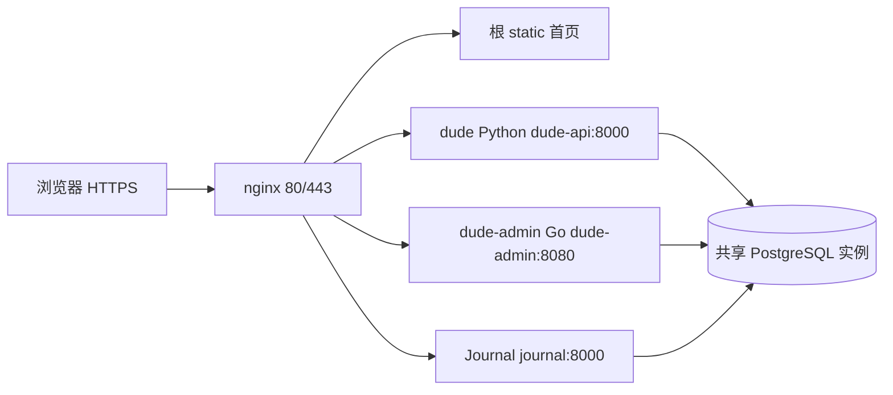

# Portal 当前项目认知

## 2026-10-28 增补：小内存部署

`scripts/update.sh [dude|journal|all|nginx]` 默认只更新 dude，不自动 Git 合并。`build.sh`、`update.sh`、`deploy.sh`、`deploy-journal.sh` 复用 `scripts/lib/deployment.sh`，共享 flock 锁及独立受限 BuildKit（512 MiB、内存加交换空间 1 GiB、0.75 CPU、内部/服务串行）。停止构建器保留缓存；失败停止部署，不自动清理镜像或回退数据库；已有 PostgreSQL 使用 `--no-recreate`。Go 编译串行、Python 使用 wheel 和锁定哈希，dude-orchestrator 不进入 Python 镜像。命令、前置条件与限制见 [部署说明](small-server-deployment.md)。这些配置不能证明事故一定由 OOM 导致，也不代表已经上线。

## 2026-10-28 增补：dude 第一阶段

最新目标以 [架构基线](../dude/docs/dude-architecture-baseline.md) 为准：Project Brief 是唯一项目事实来源，用户明确生成时冻结版本，交付技术方案与体验 Demo 的操作手册。核心动作和可见结果足够即可，用户画像与正式验收不是门槛。

新增 [dude-orchestrator](../dude/dude-orchestrator/README.md)：Node 22 / TypeScript / Fastify / Kysely / PostgreSQL，默认回环 8010，实验 `/api/v2/projects` CRUD 和只读版本 API，复用 Go JWT 与 active 账号检查。`public.dude_*` 表与独立迁移历史在现有认证数据库中，旧表不改。Repository 内部支持 revision 冲突、幂等生成、不可变 Brief、原子成对文档和删除级联。

**它尚未加入根 Compose、make dev 或 nginx；Pi、模型、聊天持久化、Wiki 适配、React 页面和新链路用量未接入。** 下方 Python 图仍是默认实际运行链路。已有 Python 会话不会自动导入新表。第一阶段测试使用独立临时 PostgreSQL，不改业务库。

核对日期：2026-10-26。受众：维护仓库的模型与开发者。范围：当前本地工作区，包含未提交的 dude 界面、管理员/用量、ChatLab 下线、规划架构及 LLM Wiki 修改；**不表示已推送、已部署或服务器运行状态**。核对时 HEAD 为 `eaa0750`。

## 阅读规则与核对范围

- 2026-10-20 对当时存在的 292 个 Git 已跟踪及非忽略未跟踪文件建立清单：读取文本结构、解析 Python AST，重点核对启动、路由、状态图、存储、配置、迁移与测试。2026-10-22 增补规划架构改动及验证；路径见 [文件索引](project-file-index.md)。
- 二进制只核对路径与类型；不读取运行时数据库、私钥、真实 .env、日志、虚拟环境或个人配置内容。忽略文件不属于版本源码，不声称检查了每个用户数据文件或完成完整安全审计。
- 新增认知文档也纳入最终索引。快照会过时，接手任务先看 Git 状态和相关实现。
- “实际行为”以路由注册/调用点/配置/测试为证；“目标范围”以 [PRODUCT](../dude/PRODUCT.md) 为准。旧教程、注释、历史 README 不足以证明功能存在。

## 1. 项目边界与运行拓扑

| 部分 | 职责 | 不负责 |
| --- | --- | --- |
| Portal 根目录 | Compose、共享 PostgreSQL、nginx HTTPS/路由、首页、开发启动器、ops/scripts/docs | 不承载 dude/Journal 业务代码 |
| dude（dude） | 新手想法澄清、默认推荐、项目方案文案、会话、知识参考 | 不写用户项目代码，不执行/部署用户项目 |
| dude/dude-admin | dude 注册登录、JWT/refresh、模型配置、管理员目录、用量查询 | 不转发聊天和 SSE，不是独立门户产品 |
| Journal | 私人动态时间线、登录、CRUD、图片，独立 PostgreSQL 库 | 不使用 dude 账号或 JWT |
| ChatHistoryAnalyst | 停用 ChatLab 源码与历史资料 | 不在首页、根级 Compose、默认开发启动中 |

项目间不直接导入源码。Python 子项目各有 pyproject.toml/uv.lock，Go 有 go.mod/go.sum；根项目依赖为空，根 `main.py` 只是 Hello 占位，不是 Web 服务入口。



根级 [Compose](../docker-compose.yml) include 三个应用 Compose；当前服务恰为 postgres、dude-api、dude-admin、journal、nginx。只 nginx 发布宿主机端口。应用依赖 postgres healthy，nginx 依赖三应用 healthy；nginx 自身没有 Compose healthcheck。

镜像/身份：pgvector/pgvector:pg16 → chalab-postgres；dude-api → dude-api；journal → portal-journal；nginx:1.28.0-alpine → portal-nginx。Journal Python 3.12 镜像以 journal UID 10001 运行；dude Python 镜像未设置非 root USER，uv 固定 0.11.26，导出锁定版本/哈希后从镜像安装 wheel。Go 为 1.22 构建、scratch 运行。版本标签不等于镜像 digest 锁定。

## 2. 入口、路由与本地差异

生产路由的唯一配置入口是 [nginx/default.conf](../nginx/default.conf)。

| 外部路径 | 目标/内部路径 | 注意 |
| --- | --- | --- |
| / | 根 static/index.html | Portal 首页，独立 CSS/JS/音乐/图片 |
| /journal、/journal/、/journal/login | journal:8000，保留 /journal 前缀 | 无尾斜杠先重定向；未登录首页跳登录 |
| /journal/api/login | Journal 原路径 | 5 次/分钟、burst 3 限流 |
| /journal/api/*、/journal/assets/* | Journal 原路径 | 独立 Cookie |
| /dude/ | dude-api:8000/ | 去掉 /dude 前缀；关闭代理 buffering，SSE read timeout 300s |
| /dude/auth/、/dude/admin/ | Go /auth/、/admin/ | 登录、管理页面 |
| /dude/auth/static/*、/dude/admin/static/* | Go /static/* | 与 Python CSS/JS 区分 |
| /dude/api/v1/auth/*、/dude/api/v1/admin/* | Go /api/v1/auth/*、/api/v1/admin/* | 旧 /dude/api/auth/*、/dude/api/admin/* 兼容 |
| /chatlab*、/css/chatlab.css、/js/chatlab.js、根 /api* | 410 | 不应重新落入静态站点或 ChatLab |

nginx 使用 Docker DNS resolver 127.0.0.11；Go 与 Journal 通用代理使用变量 upstream，但 dude 和 Journal login 仍是静态 upstream，不要说所有路由都已动态解析。HTTPS 为 TLS 1.2/1.3、现代 http2 on、HSTS、nosniff、Referrer-Policy、X-Frame-Options DENY、CSP。CSP 允许部分 inline/CDN，不能称为无 inline 的严格 CSP。证书挂载依赖宿主机已有文件，Compose 不负责签发。

本地：

- 根目录 `make dev` → Go 构建到临时目录 → dude 8001 + Journal 8002 + Go 8083 → Portal 8080，均监听 127.0.0.1。并发健康检查，启动失败或运行中子服务退出均非零退出；按端口报告占用，不杀未知进程。
- `run_dev.py:PortalHandler` 负责声明式路径分流、SSE 即时转发、重复 Cookie/错误/重定向保留、静态 resolve 边界；ThreadingHTTPServer 并发服务。`dev_server.py` 只复用代理，不启动后端。
- `/dude/auth/`、`/dude/admin/`、资源及新旧认证/管理 API 发给 Go，其余 dude 路径发给 Python；与 nginx 对外路径兼容。Go 直接默认 8080，启动器固定 8083 避免冲突。
- 开发兼容根 /api/chat、sessions、knowledge、feedback、files、handover、health 的 GET/POST 别名；生产根 /api* 全部 410。路径前缀存在不代表对应后端 endpoint 存在。
- GET/HEAD/POST/PUT/PATCH/DELETE/OPTIONS 使用同一分流；dude 会话删除和管理修改不再被代理拒绝。具体权限仍由后端校验。
- Makefile 在 Linux/WSL 直接运行，在 Windows GNU Make 通过 wsl.exe；使用 uv --frozen，子服务也遵循锁文件。根 `.env` 经 make dev 注入，直接运行脚本需自行导出变量。
- `dev_runtime.py` 以 `.portal-dev.lock` 记录 PID/starttime/目录，`make stop` 使用 pidfd 验证进程身份再发 SIGTERM；启动器只回收自己创建的进程组并等待后代退出。记录已 Git 忽略，不复制到服务器。Ctrl+C 走同一清理。
- Go DATABASE_URL 由与 Python 一致的 DB_*（回退 PG_*）派生，密码 URL 编码；不会沿用冲突的通用 DATABASE_URL。Journal 优先显式 JOURNAL_DATABASE_URL，否则由 JOURNAL_DB_PASSWORD 派生。开发启动器拒绝缺少必需凭证，不触发 Go 的旧弱默认。
- 8767/8765 等地址是历史临时预览，不能据此写成标准开发入口。

## 3. dude 当前调用链

模块导航和图见 [dude 模型地图](../dude/CLAUDE.md)，按 [00–08](../dude/docs/product-modules.md) 逐块修改。

`static/js/chat.js` → `routers/chat.py` → `core/agent.py` → `core/context_engine.py` / 存储 → `core/graph.py` → 持久化及 SSE。

公开图固定 work_arranger：router → enrich → knowledge → planner →（gap_analysis → clarify / clarify / execute）→ checkpoint → reflect。clarify 结束本轮；生成与审核有限重试。程序计算目标→范围/流程→验收依赖；产品/运行两个内部角色并行找缺口，仅输出一批最多三个可回答问题。execute 是文案生成，不是 ReAct 工具执行。

主链路已切换：PostgreSQL 结构化资料为依据，同会话追加版本；`PublishedWikiService` 只读发布版 Wiki，按标题/关键词和一跳互链组成有版本/来源摘要的参考包。`wiki_tools.cli` 独立获取选定来源、调用聊天模型编译、检查候选、管理员明确发布和回滚。在线不联网更新；没有发布时允许明确标记的 maintainer-seed，不能声称已生成正式 LLM 知识。旧 wiki_service 兼容保留但不接入。启动和图不初始化向量/嵌入/重排/向量记忆，旧代码和数据保留。见 [LLM Wiki](../dude/docs/llm-wiki.md) 与 [规划架构](../dude/docs/planning-architecture.md)。

前端为原生 HTML/CSS/JavaScript；聊天与登录已改浅色、摘要和目录按需展开，单条回复支持复制/浏览器 Blob 下载 Markdown。刷新自动恢复当前对话、单独方案版本库/最终方案服务端导出仍未完成。服务端 session export 是完整聊天记录。

### Python 实际注册 API

以下均为内部路径；生产加 /dude。权限列为当前代码事实，不是推荐权限设计。

| 方法和路径 | 文件 | 当前鉴权/语义 |
| --- | --- | --- |
| GET /api/health | app.py | 公共；PostgreSQL/Agent 未就绪返回 503 |
| POST /api/chat/message | routers/chat.py | require_user；节点级 SSE，非逐 token |
| GET /api/chat/{session_id}/contract | routers/chat.py | require_user；未检查会话归属 |
| POST /api/chat/{session_id}/contract/confirm、update | routers/chat.py | require_user；未检查会话归属 |
| GET /api/sessions | routers/sessions.py | require_user；列表未按 user_id 过滤 |
| GET、DELETE /api/sessions/{session_id} | routers/sessions.py | 当前无 require_user |
| GET /api/sessions/{session_id}/export | routers/sessions.py | 当前无 require_user；完整聊天导出 |
| POST /api/sessions/import | routers/handover.py | require_user；旧交接资料解析/注入 |
| GET /api/knowledge/search、stats；POST /api/knowledge/reindex | routers/knowledge.py | require_user；本地 Wiki 搜索/统计，reindex 返回 410 |
| POST /api/feedback；GET /api/feedback/stats | routers/feedback.py | 当前无 require_user |
| GET /api/files/download；POST /api/files/save | routers/files.py | 当前无 require_user；本地导出文件 |

旧 README 中 /api/chat/stream?v=2、/api/knowledge/upload、/api/files/upload、/api/sessions/{id}/handover 未在当前 router 注册。注释、前缀列表、数据模型、旧 JS 函数和未调用服务不能证明端点存在。

## 4. 认证、角色与数据归属

dude：

- Go AuthService 注册始终创建 user；首次 SeedAdmin 创建 admin，密码来自 ADMIN_INIT_PASSWORD。更改初始化变量不会重置已存在账号。
- Go 签发 HS256 access token，refresh token 持久化并轮转；Python 用共享 JWT_SECRET 自验。Python 当前不具备与 Go 完全相同的 issuer/必需字段验证。
- Go /api/v1/admin/* 叠加 Auth + AdminOnly；/auth/me、logout 需登录，register/login/refresh 公开。
- 管理员可查看用户 ID/用户名/角色/启用状态/创建时间、近 30 天调用与输入输出 Token，支持搜索、角色过滤、分页。用户角色调整、封号和计费不在当前新增功能中。
- 定位：Go internal/handler/users.go → internal/service/users.go → admin_users/admin_token_usage；Python graph.py → services/usage_service.py 写用量。
- 用量是异步、尽力记录，只覆盖接入的节点；缺失 usage、不具名调用和写入失败不会凭空补数。近 30 天统计不是账单；旧 /stats/* 口径也不是全部近 30 天。
- admin_model_configs 可管理，但 Python create_model 仍读取环境配置，不从该表选择模型；请求日志中间件输出日志，也不能据此假定 admin_request_logs 已写满。
- **用户隔离未完成**：sessions 建表没有 owner/user_id；部分资源未鉴权，其他路由虽验证 JWT 仍未验证 session 归属。当前 user_id 用于用量不等于所有存储按用户隔离。相关缺口归 05/07，不能宣称适合公开多用户使用。

Journal 使用独立 Argon2id 密码、随机会话令牌，仅存 SHA-256 token hash；Cookie HttpOnly/Secure/SameSite=Strict，path=/journal，期限 7 天。动态与图片查询按 user_id 限制，写操作要求 X-Journal-Request: 1。HTTP 本地 Cookie 行为需按浏览器实际测试，生产 Secure 不应为本地调试关闭。

## 5. 数据库、迁移与持久化

| 组件 | 当前数据库/用户 | 表和迁移事实 |
| --- | --- | --- |
| 共享实例 | 初始默认 chatdemopg / postgres | 根 Compose pgdata；保留历史身份 |
| dude Python | 默认 alfred / postgres | sessions/messages/feedback/task_contracts；存储类启动建表，无 Alembic |
| dude 历史知识/记忆 | 同 alfred | domain_knowledge、knowledge_chunks、session_memory、user_profile 等旧表保留；当前规划不初始化或写入 |
| dude-admin | Compose 连接 alfred / postgres | admin_* 表；migrations/*.up.sql，admin_schema_migrations 记录，由 Go 启动执行 |
| Journal | journal / journal_user | journal_users/entries/sessions/entry_images；Alembic 0001_initial → 0002_entry_images，alembic_version |
| 预留新命名 | makeitspecific / makeitspecific_user | init-projects.sh 可创建；应用尚未切换，不等于已迁移 |
| 停用 ChatLab | 历史 chatdemopg | 保留数据，不因下线删除 |

dude-admin 与 Python 共用同一产品的库和部分 admin_* 表，这是现有协作协议，不是所有子项目都各有完全隔离的 DB 用户。跨产品库边界存在，但“各项目独立最小权限用户、统一 Alembic”目标尚未全部实现。

Journal 的 ORM/鉴权/CRUD/图片都在 [app.py](../Journal/app.py)。图片保存 PostgreSQL bytea，每条最多 9 张，每张最多 8 MiB，允许 JPEG/PNG/GIF/WebP；数据库备份包含图片。列表按 created_at DESC、id DESC，编辑不把旧动态重新排到最上方；前端不要求用户选日期，但 payload 仍有 entry_date/title。

Journal 路由：/journal/、/journal/login、/journal/health、/journal/assets/*；API login/logout、GET/POST entries、PUT/DELETE entries/{entry_id}、POST entries/{entry_id}/images、GET/DELETE images/{image_id}。Docker 启动先 alembic upgrade head；直接开发 uvicorn 不自动迁移。`create_user.py` 默认 yoiwerr，交互输入或安全环境变量，**存在同名用户时会更新密码**。

init-scripts 的 SQL 只在空 volume 初始化阶段运行；已有库用 ops/postgres/init-projects.sh 创建缺失 journal/makeitspecific 角色/库并更新这两个角色密码，不迁移/重命名 alfred。执行初始化也有密码变更副作用，先核对已有部署。

## 6. 配置与运维定位

| 位置 | 模型应核对的内容 |
| --- | --- |
| 根 .env.example | 部署变量模板；真实 .env 不随 Git 分发 |
| dude/config.py | 已导出的进程环境优先；dotenv 选择根 .env，否则子项目 .env |
| Python 数据库 | DB_HOST/DB_PORT/DB_NAME/DB_USER 优先，回退 PG_HOST/PG_PORT/PG_DATABASE/PG_USER，密码 PGSQLPASSWORD |
| dude-api Compose | 注入 DB_HOST/DB_PORT/DB_NAME/DB_USER，保留 postgres/alfred 兼容地址 |
| usage_service.py | DB_* 优先、PG_* 回退；已与主存储优先级对齐 |
| LLM 工厂 | dashscope/deepseek/openai/local/auto；OpenAI 自定义 base_url/model 由 config 读取 |
| dude-api Compose 模型变量 | 已注入 OPENAI_BASE_URL/OPENAI_MODEL；其他参数仍需逐项核对，.env 不会自动全部变为容器环境 |
| Wiki/来源 | DUDE_WIKI_PUBLISHED_DIR（本地覆盖路径）、DUDE_WIKI_ALLOW_SEED；Compose 只读挂载发布目录；OFFICIAL_REFERENCE_ENABLED 停用，MEMORY_ENABLED 不启用向量记忆 |
| Go config | 只读进程环境，不自动 dotenv；直跑仍有弱默认值，Compose 才有必填约束 |
| Journal | JOURNAL_DATABASE_URL 必填；Compose 由 JOURNAL_DB_PASSWORD 组成连接串 |
| scripts/check-production-config.sh | Docker Compose >=2.20.0、必需变量、部分长度、证书、Compose config |
| scripts/deploy.sh / update.sh | 人工部署/更新辅助，不能替代实际健康和业务验收 |
| scripts/deploy-journal.sh | Journal 专项构建、迁移与 nginx 更新 |
| ops/postgres/ | 初始化、备份、恢复、systemd 示例 |

不要打印含插值密码的完整 `docker compose config`；常规检查使用 --quiet，服务列表用 --services。不要把文档示例账号或聊天中出现的密钥写回配置。

备份：backup.sh <db> 用 pg_dump custom、no-owner/no-privileges，先写 .partial、用 pg_restore --list 验证目录、再更名；按数据库文件名前缀删除 -mtime +7 的 dump（按完整天数计算，并非精确 168 小时保留线）。默认 /var/backups/portal/postgres。timer 每天 02:30，Persistent=true；service 默认 /root/portal，备份 journal 和 alfred，可按实际部署改路径和数据库。

恢复：restore.sh 仅接受 journal/makeitspecific/dude/chatdemopg，要求输入 RESTORE <db>；使用 --clean --if-exists，会替换目标对象，库需先存在。脚本不能直接恢复到任意临时库，临时库演练按 [备份恢复文档](postgresql-backup-and-restore.md) 手动 pg_restore。no-owner/no-privileges 不保存角色/授权，恢复后应核对 journal_user 等业务用户权限。目录验证不等于实际恢复成功，本机 dump 也不等于异地备份。

Wiki 原文、候选与发布产物位于 dude/var/，Git 忽略、镜像排除；数据库备份不包含它们。需单独复制/备份和演练，详见 [LLM Wiki 运维](../dude/docs/llm-wiki.md)。Git 拉取不会自动携带本地发布版本。

ChatLab 的外部快照位置及恢复见 [下线说明](chatlab-retirement.md)。快照可能含私有文件，不提交；它不是 PostgreSQL 数据备份。源码仍在版本库，不能自行启动旧子 Compose（会与共享 postgres 发生边界冲突）。

## 7. 验证入口与副作用

先按任务选择，不应无条件对真实库跑整个测试目录。以下命令从 Portal 根目录开始；子项目测试用括号进入自身目录以免同名 app/config 导入混淆。

```bash
python3 -m unittest discover -s tests -p 'test_chatlab_retirement.py' -v
(cd dude && uv run --frozen python -m pytest tests/test_graph.py tests/test_planning.py tests/test_planning_flow.py tests/test_usage_identity.py tests/test_project_state.py tests/test_wiki_service.py tests/test_llm_wiki.py tests/test_planning_startup.py -q)
node --test dude/dude-admin/tests/auth.test.cjs
(cd dude/dude-admin && go test ./...)
git diff --check
```

| 验证 | 条件和限制 |
| --- | --- |
| Python AST/语法扫描 | 不导入应用，不证明依赖、DB 或服务可启动 |
| test_planning*、test_graph、test_usage_identity | 替代模型离线回归，不证明真实模型输出品质 |
| test_llm_wiki | 临时目录、模型/HTTP 替身；编译发布回滚、篡改/路径边界、在线只读、上下文与来源传递；不访问现有数据库 |
| tests/test_chatlab_retirement.py | 代理/退役 URL/静态路径测试，无在线服务 |
| tests/test_dev_integration.py | 临时 HTTP 后端、SSE 首事件、认证/管理分流、静态越界、端口/进程身份与停止回归，不访问业务数据库 |
| dude-admin auth.test.cjs | Node 测试含前端模拟 DOM/SSE；不是完整真实浏览器验收 |
| dude test_auth_routing.py | 需要 nginx + openssl，缺失会 skip；使用隔离 upstream/证书 |
| dude test_session_store.py | 按当前配置连接真实 PostgreSQL并建表/写数据，不可直接指向生产 |
| dude test_planning_postgres.py | 仅显式 DUDE_PLANNING_TEST_DATABASE_URL，数据库名 alfred_planning_test 前缀；建表写入，必须独立测试库 |
| Go TestUserDirectoryPostgres | 需 ALFRED_ADMIN_TEST_DATABASE_URL，限定 alfred_roles_test 前缀，临时 schema；无变量 skip |
| Journal tests/test_images.py | 需 JOURNAL_TEST_DATABASE_URL，强制 journal_test；会 drop_all/create_all，不能指向业务库 |
| scripts/smoke-test-journal.py | 默认直接访问生产域名并创建/修改/删除一条动态，需要账号；非纯只读检查 |
| docker compose config --quiet、nginx -t | 需 Docker/证书与适当网络；不能以 YAML 解析代替运行验证 |
| Journal Alembic /恢复演练 | 必须在明确目标数据库验证，不由文档任务自动执行 |

2026-10-22 已执行规划离线回归及独立临时 PostgreSQL 16 的保存/版本/旧资料兼容测试，未连接服务器、调用真实模型或写业务数据库。当前 WSL 未发现 docker/nginx 命令，未执行 Compose 与 nginx 运行检查。细项见 [规划架构验证](../dude/docs/planning-architecture.md#验证与尚未验收的部分)。

随后 08 本地联调增加真实 Go/Python/Journal 栈的隔离数据库验证，范围和剩余限制见 [本地开发验证](local-development.md)。这不代表生产部署或真实模型沟通质量已验收。

## 8. 文档层次与维护

- [AGENTS](../AGENTS.md)、[CLAUDE](../CLAUDE.md)：短入口和开发边界。
- 本文：当前跨项目架构与差距；[文件索引](project-file-index.md)：所有版本文件路径和检索入口。
- [dude CLAUDE](../dude/CLAUDE.md)：当前代码链路；PRODUCT：确认的产品范围；product-modules：逐块修改职责。
- README 面向操作；frontend-refresh 描述前端这次变更；dude-admin README 描述认证/统计。
- CONTROLWEB、docker-deploy-guide、旧 dude-admin-architecture、agent-course/done/to_log/面试资料含历史内容，不能覆盖当前代码事实。
- 新增功能/改路由后更新实际相关几份文档即可，不把每次聊天记录、测试账号或部署密码追加到模型入口。需要历史背景时再读 [历史记录](history/model-context-history.md)。
