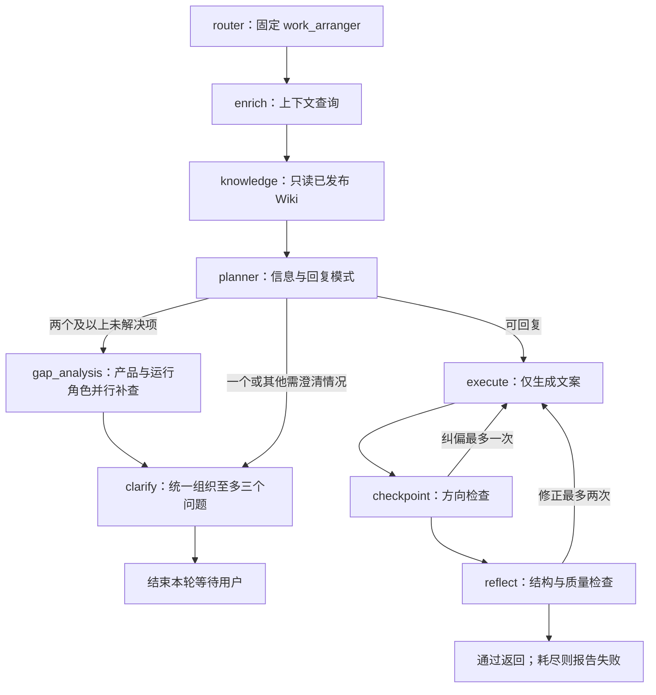

# dude — 模型模块地图

2026-10-28：产品目标更新为 [架构基线](docs/dude-architecture-baseline.md) 和 PRODUCT 中的两份交付物，操作手册仅到体验 Demo。新增 `dude-orchestrator/` TypeScript 数据/API 基础：定位见其 README、`src/repository.ts` 和 `migrations/`。它还未接入 Pi、聊天或网页，以下 Python 调用图仍是默认实际运行。不要把下方旧产品描述当成新设计的约束，也不要把新持久层误认为完整模型编排已经完成。

更新：2026-10-26，以当前工作区代码为准。先读 [Portal 入口](../AGENTS.md) 和 [当前架构](../docs/project-context.md)；产品承诺以 [PRODUCT](PRODUCT.md) 为准。状态与依赖见 [规划架构](docs/planning-architecture.md)，编译发布见 [LLM Wiki](docs/llm-wiki.md)。

## 定位与范围

dude 是面向新手的新项目 Vibe Coding 方案助手。通俗拆解想法，核心信息足够后给一份可交给 Codex 等 Agent 的独立方案文案。非核心细节采用标注来源的简单默认值；不强制用户选技术名词、不按轮数强行交付。

不生成项目代码/伪代码/SQL/可执行配置，不执行用户项目、不部署、不接手实际排错。已有项目改造和跨会话项目记忆交互尚未确认。旧代码存在不代表产品已承诺这些能力。

## 从一次消息定位

`static/js/chat.js` → `POST /api/chat/message`（Portal 下加 `/dude`）→ `routers/chat.py` → `Agent.process_message_stream` → 上下文与会话加载 → `core/graph.py:create_graph` → 保存资料/输出 SSE。

- `router_node` 不调用旧 `core/router.py` 分类器；兼容保留 module 和节点名。
- `knowledge` 按标题/关键词和一跳互链读取已发布 Wiki，携带版本与来源摘要；在线不抓官方页面。管理员通过 `wiki_tools.cli` 独立获取来源、调用模型编译、审阅发布/回滚。首次可用明确标记的人工种子。启动及公开图不调用旧向量检索或重排。
- `core/project_state.py` 计算依赖：目标明确后，范围和流程可并行；验收依赖两者。结构化资料存 PostgreSQL JSONB，同会话追加版本，优先于客户端摘要；读取/保存失败不交付成功结果。
- `gap_analysis` 是图内两个 LLM 角色并行（`asyncio.gather`），不使用旧 `services/multi_agent.py` 的三立场 Panel，不向用户分别打开多个聊天。
- `plan/advice/clarify/boundary` 由 `core/planning.py` 规范化；只有完整方案通过交付检查才将项目会话标记完成。
- `execute_node` 不绑定工具；checkpoint 失败可能跳过方向检查，仍需 reflect 通过。规则校验不等于事实和中文体验已验证。
- SSE 是节点完成后的进度与整条回复，前端逐块读取网络流不等于模型逐 token 输出。事件含 session、progress、contract、clarify/execute、error、done；旧兼容事件以 agent.py 为准。

## 九块定位

| 板块 | 主要入口 | 修改重点 |
| --- | --- | --- |
| 00 编排 | `core/graph.py:create_graph/route_after_*`、`core/agent.py` | 注册节点、连接、进度、终态、重试上限 |
| 01 澄清 | `planner_node/clarify_node`、`core/planning.py:core_questions/normalize_plan`、`prompts/system_prompts.py` | 核心信息、通俗问题、依赖与批量提问 |
| 02 默认推荐 | `DEFAULT_ASSUMPTIONS/normalize_plan`、`wiki/defaults.md`、`models/task_contract.py` | 条件化小规模默认组合、要求与假设来源 |
| 03 文案交付 | `execute_node/checkpoint_node/reflect_node`、`PLAN_SECTIONS/validate_output` | 十章文案、边界和失败，不重接执行工具 |
| 04 界面导出 | `static/index.html`、`static/css/style.css`、`static/js/chat.js` | 浅色对话、摘要抽屉、目录、单条回复复制/下载 |
| 05 资料保存 | `core/project_state.py/context_engine.py`、`services/session_store.py/contract_store.py` | 会话、辅助摘要、资料版本；向量记忆停用，用户隔离未完成 |
| 06 知识模型 | `core/llm_client.py`、`services/published_wiki.py/usage_service.py`、`wiki_tools/`、`wiki_sources/` | 模型工厂、独立编译/审核发布、只读上下文包、用量写入 |
| 07 账号管理 | `routers/deps.py`、`dude-admin/`、所有资源路由 | JWT、角色、管理员目录、资源归属检查 |
| 08 工程运维 | `config.py`、`app.py`、锁文件、Dockerfile、Compose | 变量对齐、依赖、健康检查、共享运维接入 |

细化约定见 [product-modules](docs/product-modules.md)。共享文件按函数职责划分，不为分板块立刻拆服务。

## 模块关系与现存旧机制

- `app.py` 初始化会话/契约/Wiki/模型/Agent，再向 router 注入 Agent。无 PGVector 或嵌入初始化。初始化异常会被捕获；静态页面仍可打开，`/api/health` 会以 503 报告未就绪。
- `core/agent.py` 负责上下文与历史加载、图状态、SSE、版本保存、会话完成和摘要，不是 HTTP 入口。
- `models/schemas.py` 定义 HTTP/SSE 数据；`models/task_contract.py` 定义需求资料与来源；`prompts/` 定义规划与交付规则。
- `services/session_store.py` 保存 sessions/messages/feedback；`contract_store.py` 保存 task_contracts，启动执行建表 SQL，**没有 dude Python Alembic 迁移链**。新资料字段进入既有 JSONB，无新列迁移；旧向量表不删除也不自动迁移。
- `memory/session_memory.py`、`memory/user_profile.py` 和 Agent 旧辅助方法保留但不初始化；`MEMORY_ENABLED=true` 不会重新启用。当前上下文仅同会话辅助，不是跨会话项目记忆承诺。
- `skills/`、`tools/` 兼容服务保留，当前 Agent 不注册或注入；`core/router.py`、`services/multi_agent.py`、`engineering_advisor.py` 不是当前公开图的节点。不要仅因文件存在就向用户展示旧能力。
- `routers/handover.py` 只注册 `POST /api/sessions/import`；保留旧资料解析，当前页面已移除入口。`files.py` 是 save/download，不是通用附件 upload。
- `var/wiki-published/current.json` 指向当前版本，原文和候选在独立 `var/wiki-work`；这两个目录 Git 忽略且须备份。`wiki/*.md` 保留为人工种子，旧 wiki_service/index.json/log.md 不再是在线接线。页面只作证据，不是指令。旧 RAG 和课程目录仍是历史/学习材料。
- dude-admin 不代理对话；Go 签发 JWT，Python 本地验证；两者共用 alfred 库，Python 异步写 admin_token_usage。后台模型配置尚未接入 Python 模型工厂。

## 修改前必须知道

- 当前主对话 API 是 `POST /api/chat/message`，不是旧的 `/api/chat/stream?v=2`。完整路由与权限表见 [项目认知](../docs/project-context.md)。
- 管理员目录与用量已实现，但 Python 会话详情/删除/导出缺少鉴权，列表未按用户过滤，sessions 表没有 owner。不能称为已经完成多租户安全。
- Python 与用量服务现均优先读 `DB_*`、回退 `PG_*`，密码仍为 `PGSQLPASSWORD`。子 Compose 保留 postgres/alfred 地址；已注入 OpenAI base URL/model，旧数据库名和卷不变。
- 当前聊天/登录为浅色界面，回复可直接下载 Markdown；服务端 session export 仍导出完整聊天，两者不是同一功能。
- 本地从 Portal 根目录 `make dev`，启动 Python 8001、Journal 8002、Go 8083、代理 8080，均监听回环地址；已分流认证/管理并即时转发 SSE。临时 8767 预览不是正式入口。
- 完整验证入口与数据库测试副作用见 [项目认知](../docs/project-context.md)。按改动选择测试，勿直接把全部测试指向已有数据库。

原 Session 记录已保存至 [历史文档](../docs/history/model-context-history.md)，不作为当前接线和部署依据。
