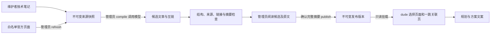

# dude LLM Wiki：编译、审阅、发布与回滚

更新：2026-10-26。本地实现，不表示已推送或服务器已切换。职责属于 06 知识库，必要联动 08 配置；不改变聊天产品范围、前端、认证或数据库。

## 采用什么

参考 [nvk/llm-wiki](https://github.com/nvk/llm-wiki/tree/d60674ff785e5c6d35322657d7839a7c0bdd3ca7) 的源码资料→知识文章→互链→人工维护模式，研究基线固定为该提交。它的 `compile` 是 Agent 工作流说明，Python CLI 主要提供确定性辅助检查，不能当作一个现成编译 API。

本项目实现独立 Python 适配层，复用既有聊天模型客户端，实际调用模型综合选中来源并产生文章。没有安装上游插件，也不声称完整兼容上游所有字段、命令或 lint。文章使用 concept/topic/reference 分类、来源路径、置信度、时效分类和双格式互链；编译绝不生成 `verified`。`bundle.json` 是本适配层的权威数据，Markdown 是可审阅的派生文件。



不使用向量分块、embedding、重排或向量记忆。在线仍需要“选择相关知识并交给模型”的参考机制，这不等于完全不检索：首版使用标题/关键词与一跳互链，不另加一次选页 LLM 调用。旧 RAG 源码、依赖与表留存，但主链路不启用。

## 文件和权限

| 路径（dude 下） | 内容 | Git / 访问权限 |
| --- | --- | --- |
| `wiki_tools/` | 编译、格式检查、CLI、种子适配 | Git；管理命令，在线不调用编译器 |
| `services/published_wiki.py` | 发布版本校验与只读上下文包 | Git；在线使用 |
| `wiki/defaults.md`、`wiki/access-and-data.md` | 既有人工种子笔记 | Git；明确标为 maintainer-seed |
| `wiki_sources/notes/` | 新增的通用技术笔记 | 审阅后入 Git，不存用户资料 |
| `var/wiki-work/raw/` | 来源内容摘要命名的不可变快照 | Git 忽略；仅管理员 |
| `var/wiki-work/sources.json` | 各来源当前选用的快照 | Git 忽略；仅管理员 |
| `var/wiki-work/candidates/<SHA>/` | bundle、可读 Markdown、原文、REVIEW.md | Git 忽略；仅管理员 |
| `var/wiki-published/releases/<SHA>/` | 已发布 bundle 和 Markdown | Git 忽略；应用只读 |
| `var/wiki-published/current.json`、`history/` | 原子切换指针、激活尝试记录 | Git 忽略；应用只读 |

原始内容只留在管理员工作目录。发布 bundle 保留出处、抓取时间、来源摘要及快照路径，不带原文。完整来源链接在候选目录可阅读；发布页里的 raw 路径用于追溯，需要管理员工作目录/备份才能打开。搜索 API 不开放原文下载。

“管理员”在此指有服务器运维权限、能执行 CLI 的人。首版没有 Web 编译/发布 API，不依靠传入一个 reviewer 字符串做身份认证；`--reviewer` 是操作记录，真实授权靠 Linux 账号和目录权限。容器只读挂载发布目录，工作目录通过 `.dockerignore` 排除，不进入应用镜像。不要把编译命令接到聊天工具或公共 HTTP 路由。

## 本地从零运行

Linux/WSL、Python 3.12，使用现有锁文件，不新增库。下面从子目录执行的是管理工具；日常启动整个 Portal 仍在根目录 `make dev`。

```bash
cd /home/yoiwerr/portal/dude
uv sync --frozen
uv run --frozen python -m wiki_tools.cli init
uv run --frozen python -m wiki_tools.cli status
```

`init` 仅快照化两篇既有人工笔记，不调用模型、不发布。没有发布版本且 `DUDE_WIKI_ALLOW_SEED=true` 时，在线显示 `mode=maintainer-seed`、`published=false`；这是兼容首次启动的人工参考，不表示已跑过 LLM 编译。设为 false 可强制先发布，缺少可读版本时应用健康检查失败。

补充资料（按需）：

```bash
# 先人工编写、检查 wiki_sources/notes/small-websites.md，再导入。
uv run --frozen python -m wiki_tools.cli ingest-note small-websites
# 仅允许 python、postgresql、django 三个固定官方页面。
uv run --frozen python -m wiki_tools.cli refresh postgresql
```

`refresh` 验证 TLS、禁止重定向/环境代理、15 秒总超时、解压后最多 256 KB、提取文本最多 64 KB；失败保留之前的来源选择。源内容变化新增快照，不覆盖旧文件。不接受任意 URL、聊天记录、用户方案或自动扫描旧知识库。抓取成功不是事实验证，免费额度、商业价格等不在这份白名单覆盖范围内。

编译会使用根 `.env`（不存在时使用子 `.env`）已有的 `LLM_PROVIDER` 和对应模型配置；与聊天模型客户端相同。不读写数据库，可能产生模型费用，CLI 用量暂不计入用户后台统计。先确认提供方及模型支持文本 JSON 输出，密钥留在未入 Git 的 `.env` 中。

```bash
uv run --frozen python -m wiki_tools.cli compile
# 或明确仅选择这些来源；这是完整新版本，不会自动混入旧发布页。
uv run --frozen python -m wiki_tools.cli compile --source defaults --source access-and-data
```

单次最多 24 个来源、总原文 80 KB，输出 2–16 页，每页最多 8000 字。首版完整重编选中语料，超限报错，不偷偷截原文；还不是大规模增量 Wiki。源码更新后须重新编译，已有发布不会被原文更新自动改变。

命令返回候选摘要和路径。打开整个候选目录，检查正文是否准确、默认建议适用条件是否清楚、来源是否支持结论、冲突有没有保留、链接有没有指向正确主题。结构检查不能判断这些语义问题。

```bash
# 将返回的完整 64 位摘要填入；不要填短前缀。
WIKI_DIGEST=填写完整候选摘要
uv run --frozen python -m wiki_tools.cli check "$WIKI_DIGEST"
# 阅读候选正文与原文后，再执行明确发布。
uv run --frozen python -m wiki_tools.cli publish "$WIKI_DIGEST" --reviewer yoiwerr --confirm "$WIKI_DIGEST"
uv run --frozen python -m wiki_tools.cli status
```

候选被手动修改会导致摘要检查失败。若要调整结论，修改人工来源并重编，审阅新摘要，不要绕过校验去改发布目录。`seed-candidate` 可以生成不调用模型的人工候选，走相同审阅/发布流程，但 mode 始终为 maintainer-seed，不能作为真实模型验证结果。

## 在线行为和回滚

发布后下一次知识请求会读取新版本，不需重启整个服务。只读服务先完整校验 bundle 摘要和所有派生页，再组装最多 18000 字符的参考包；页面出处包含 release、page_sha256、compiled_at 和来源 SHA，沿现有 references 字段传给规划器并存入任务资料。`reviewed_at` 为激活时间，不是事实全部人工核验的日期。

错误不会自动覆盖旧发布：模型/结构检查失败不能发布；发布需要确认完整摘要。读取失败时，运行中的服务保留上次完整校验通过的内存快照并报告 `degraded=true`；冷启动可读取指针中的 previous 版本。指针本身损坏且冷启动没有可用指针时失败，不猜测任意“最新目录”，也不悄悄退回种子。

```bash
OLD_WIKI_DIGEST=填写已存在的旧发布摘要
uv run --frozen python -m wiki_tools.cli rollback "$OLD_WIKI_DIGEST" --reviewer yoiwerr --confirm "$OLD_WIKI_DIGEST"
```

使用进程锁串行化写操作、文件/目录 fsync、同文件系统目录重命名以及原子指针替换；版本目录不原地覆盖。history 先记录操作意图，current.json 替换才是提交点；发生磁盘错误后须检查 status，不能仅看到 history 就判定成功。不要由别的脚本修改 releases/current.json。删除旧版本前确认它既不是 active/previous，也没有恢复用途；首版不自动清理。

聊天服务始终不联网抓取参考。旧 `OFFICIAL_REFERENCE_ENABLED` 已停用，即使 `.env` 留有 true 也不会打开实时抓取。询问最新版本/价格/配额时仍标记未实时核实，不能把抓取时间或编译时间当作事实今天有效的证明。

## 服务器更新与 Git 之外的文件

代码可以由 Git 拉取；**`.env`、`var/wiki-work/` 和 `var/wiki-published/` 不会随 Git 上传或自动到服务器**。可直接在服务器管理账号下编译和发布，或将本地已审阅候选目录完整复制到服务器的 `var/wiki-work/candidates/<SHA>/`，然后在服务器 `check`、`publish`，不要只复制一张 Markdown。

服务器一次性准备（已有目录保留，不删除）：

```bash
cd ~/portal
mkdir -p dude/var/wiki-work dude/var/wiki-published
chmod 700 dude/var/wiki-work
cd dude
uv sync --frozen
# 按上述 init -> 可选 refresh -> compile -> check -> publish 执行。
```

发布成功后，可手动在服务器根 `.env` 写入 `DUDE_WIKI_ALLOW_SEED=false`，保留已有密码与模型配置。本地若覆盖发布路径使用 `DUDE_WIKI_PUBLISHED_DIR`；Compose 内固定为 `/var/lib/dude-wiki`，将子项目 `var/wiki-published` 整个目录只读挂载，避免只挂载指针单文件而收不到原子替换。

```bash
cd ~/portal
docker compose config --quiet
docker compose up -d --build dude-api
docker compose exec -T dude-api curl -fsS http://localhost:8000/api/health
docker compose exec -T dude-api python -c 'from config import config; from services.published_wiki import PublishedWikiService; print(PublishedWikiService(config.wiki_published_dir, allow_seed=False).stats())'
```

现有 dude 镜像仍以 root 运行；若另行改成非 root，须给容器 UID 对发布目录及文件的读取/遍历权限，不能授予写入。此次不改 PostgreSQL 卷、表或用户，也不需要运行迁移。

## 备份和恢复演练

数据库备份不包含 Wiki 文件。停止管理写操作期间，另行备份 `var/wiki-work` 和 `var/wiki-published`，保留至少 active、previous 及其候选和原文；长期保留多少由知识更新频率决定。不要把归档放回 Git。示例归档目录需预先建立并限制权限：

```bash
cd ~/portal/dude
tar -czf /srv/backups/dude-wiki-$(date +%F-%H%M%S).tar.gz var/wiki-work var/wiki-published
```

将归档复制到异机/对象存储，最好加密。恢复演练先解压到一个新的临时目录，不覆盖现有 var，然后用 `--work <临时目录>/var/wiki-work --published <临时目录>/var/wiki-published check <SHA>` 校验候选，再用相同路径参数执行 `status`（参数放在子命令前）。确认 mode/release/degraded，必要时读候选原文。正式恢复停管理写入和 dude，将验证过的两目录恢复至原路径和权限，启动并确认健康与 release。只有数据库恢复成功不代表 Wiki 也可恢复。

## 验证范围

离线回归使用替代模型、HTTP MockTransport、独立临时目录，覆盖真实 compile/check/publish/rollback 代码、来源/页面篡改、链接/引用错误、抓取失败、只读服务热切换与降级、上下文限额和来源沿图传递。

```bash
uv run --frozen python -m pytest tests/test_llm_wiki.py tests/test_planning_startup.py tests/test_planning_flow.py -q
```

2026-10-26 本轮通过 28 项 Wiki 测试、91 项既有规划/启动回归、21 项根目录回归；Python 语法/警告、变更文件空白、git diff --check、Git 忽略及无关文件基线核对通过。Compose YAML 与只读挂载路径静态检查通过；当前环境没有 Docker/nginx，未执行 docker compose config 或容器检查。

本轮未调用真实模型生成正式候选，未发布知识或部署服务器。默认仍可运行明确标记的人工种子。离线测试不证明真实模型综合质量，也不等于官方网页当日可用或完整多用户隔离已完成。当前会话资源归属缺口仍应由 07 单独整改；Wiki 不接收用户资料，不能解决已有账号隔离问题。
