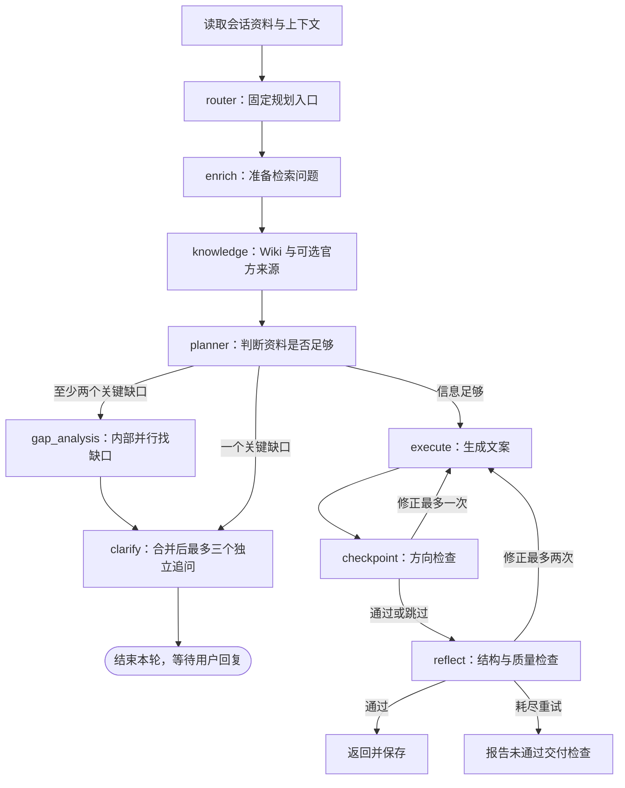

# dude 板块划分与逐块修改约定

更新时间：2026-10-22（按当前工作区核对，不代表已部署）。产品边界以 [PRODUCT.md](../PRODUCT.md) 为准，阶段目标见 [优化路线](product-roadmap.md)。本轮按确认的组合方案联动 00/01/02/05/06 与必要配置，具体设计见 [规划架构](planning-architecture.md)；不改变 04/07 产品范围。

后续按下列编号一次修改一个板块。这里划分的是职责和改动范围，不是已经拆开的独立服务。按当前职责逐块调整，不为了划分而移动目录或增加服务。

## 板块总览

| 编号 | 板块 | 用户关心的问题 | 当前状态 |
| --- | --- | --- | --- |
| 00 | 对话流程与节点编排 | 一条消息经过哪些步骤，何时追问、回答或重试？ | 首轮已移除空节点及不可达分支，真实模型体验待验证 |
| 01 | 想法澄清 | 我只有一个想法，怎么把需求聊清楚？ | 已有首轮核心信息判断与通俗追问，真实模型效果待验证 |
| 02 | 默认方案与技术推荐 | 我不懂技术，该怎么选？ | 已有 Wiki 条件化默认组合和来源；真实模型推荐效果待试聊 |
| 03 | 方案生成与交付检查 | 聊完后，拿到什么才能让 Agent 开始做？ | 已有十章文案、结构检查、模型审核及失败重试 |
| 04 | 界面、方案展示与导出 | 哪里聊天、哪里看方案，怎么带走？ | 浅色对话、可展开摘要/目录、单条回复下载已实现；服务端仍导出聊天记录 |
| 05 | 会话、上下文与资料保存 | 这一轮聊过的要求会不会忘？ | PostgreSQL 资料版本为依据；向量记忆停用，跨会话产品设计待调研 |
| 06 | 知识库、检索与模型接入 | 推荐依据从哪里来，模型能否稳定响应？ | Wiki 目录/关键词 + 可选官方来源；启动与图不再依赖嵌入/重排 |
| 07 | 登录、权限与管理后台 | 谁能登录，谁能看哪些数据，管理员怎么管理？ | 登录刷新与管理员用户/用量页已实现；Python 资源鉴权/归属仍有缺口 |
| 08 | 配置、开发启动与部署运维 | 本地和服务器能否稳定运行？ | DB/PG 已对齐；根级开发启动已接 Go 认证/管理、SSE、受控停止，生产验证另行进行 |

00 管理流程连接，01–04 是主要产品体验，05–08 提供运行基础。每个板块都包含自己的测试和必要文档，不把测试推到最后集中补。

## 00：对话流程与节点编排

负责图的入口、节点职责与连接、分支条件、重试上限及最终状态。它消费 01/02 的需求与回复模式、调用 03 的文案和检查节点，不顺带改提问规则、技术默认组合或方案章节。

主要改动位置：

- [graph.py](../core/graph.py)：`create_graph`、条件路由及节点接线。
- [agent.py](../core/agent.py)：图调用、状态初始化、节点进度与终态事件。
- [test_planning_flow.py](../tests/test_planning_flow.py)：真实图分支与 SSE 的离线回归。

当前流程：

每次消息先读取 PostgreSQL 项目资料，再补充同会话上下文。`knowledge` 每轮读取小型 Wiki；时效问题只有启用联网且命中固定官方目录时才发请求，不能核实则标记。`planner` 提取资料，`core/project_state.py` 计算目标→范围/流程→验收依赖。至少两个未解决项时内部角色并行补查，但输出问题必须属于当前可回答的缺口，最后只发一批最多三个问题。一个缺口直接追问；建议/边界回复只结束本轮，完整方案经检查并保存后才标记完成。

首轮整改范围：

- 移除图中空的 `engineering_check` 及不可达的旧 `multi_agent` 节点、接线与专属包装函数；历史服务文件留存。新增职责明确的 `gap_analysis`，只并行提出缺口，不直接生成用户回复。
- Planner 根据缺口选择直接追问、先做并行缺口检查再追问，或进入文案链路；不再经过旧输出文本的“阻断”关键词判断。
- 保留 `router`、`execute` 等公开进度名、模块字段和交付 SSE 事件以兼容现有前端；增加 `gap_analysis` 进度事件，注释明确其真实职责。
- 移除图内已无作用的追问轮数阈值。旧 `skills/config` 构造参数保留调用兼容，不用于强行交付。
- 验证四种回复模式的实际节点序列、并行缺口合并、最多三个独立追问、时效资料按需检索、方向与质量修正上限、检索参考传递，以及成功/失败会话状态。

保留待后续评估的问题：Planner 仍同时处理需求与默认值；普通建议仍经过两层审核；Checkpoint 调用或解析失败仍跳过方向检查，最终还需 Reflect 通过。这轮不改变这些策略，避免将 01、02、03、06 的内容调整一起打包。

验收：每条注册分支可达且有明确职责；核心信息不足只追问；重试有限且使用同一文案路径；失败不发送最终方案成功事件；旧客户端仍能展示进度并接收结果。离线替代模型用于流程验证，不能代表真实沟通效果或部署验证。

## 01：想法澄清

负责理解目标、使用者、第一版功能、实际流程及验收结果；决定什么时候追问、什么时候信息足够。用例子问核心问题，不让新手填技术问卷。

主要改动位置：

- [system_prompts.py](../prompts/system_prompts.py)：`PLANNER_SYSTEM_PROMPT` 的理解、追问和回复模式规则。
- [graph.py](../core/graph.py)：`planner_node`、`clarify_node`、追问格式化；节点接线归 00。
- [planning.py](../core/planning.py)：`CORE_QUESTIONS`、`core_questions`、`normalize_plan` 的核心信息判定。
- [templates.py](../prompts/templates.py)：规划维度与追问提示。

修改此块时不同时更换技术默认组合、重做方案模板或调整页面布局。

验收：模糊想法得到最多三个互不依赖的关键问题（与当前 00 批量追问实现一致）；已说清的内容不反复问；技术不懂可以继续推进；核心矛盾未解决时不强行交付。用读书记录、预约工具、展示网站等新项目做试聊。

## 02：默认方案与技术推荐

负责在用户不懂或没有偏好时给出成熟、简单、小规模的推荐，解释适用场景、优缺点、维护与费用。区分用户要求和默认假设，不以简化为理由牺牲核心功能、安全或持久化。

主要改动位置：

- [planning.py](../core/planning.py)：`DEFAULT_ASSUMPTIONS`、`normalize_plan` 的默认值与来源处理。
- [system_prompts.py](../prompts/system_prompts.py)：默认推荐和技术解释规则。
- [task_contract.py](../models/task_contract.py)：`confirmed_requirements`、`assumptions` 等资料字段。
- [wiki/defaults.md](../wiki/defaults.md)、[wiki/access-and-data.md](../wiki/access-and-data.md)：场景化推荐；目录和读取规则归 06。

目前已整理单机工具、小型跨设备网站两类默认参考，明确适用条件和代价；不做庞大的框架菜单。Wiki 的人工审阅和流程测试不代表真实模型输出已经验收。

验收：「按最简单的来」可得到明确推荐与理由；个人、多用户、公开展示等实际需求影响推荐；用户指定的技术或功能不被默认覆盖；默认假设不会变成“用户已确认”。

## 03：方案生成与交付检查

负责把充分明确的资料写成一份自包含文案，供用户与编程 Agent 共用。负责检查遗漏、矛盾、验收覆盖、默认来源与产品边界，以及重试和失败结果。

主要改动位置：

- [system_prompts.py](../prompts/system_prompts.py)：`EXECUTOR_SYSTEM_PROMPT`、`REFLECTOR_SYSTEM_PROMPT`。
- [planning.py](../core/planning.py)：`PLAN_SECTIONS`、`validate_output`。
- [graph.py](../core/graph.py)：`execute_node`、`checkpoint_node`、`reflect_node`、交付问题判定；重试接线与上限由 00 维护。
- [agent.py](../core/agent.py)：交付状态和对应 SSE 结果事件；会话资料保存规则归 05。

不在这里做导出按钮、聊天布局或认证改造。生成节点只输出文案，不接回旧执行工具。

验收：方案脱离聊天可用；目标、流程、数据权限、阶段任务、部署备份成本和验收一致；不含代码或可执行配置；失败明确报告，不能显示最终方案已经完成。结构检查不能替代真实模型效果和语义验证。

## 04：界面、方案展示与导出

负责用户看得到的聊天入口、追问、生成进度、方案阅读、复制与下载。把“任务契约”“Agent Panel”等内部术语转成用户能理解的表达。

主要改动位置：

- [index.html](../static/index.html)、[style.css](../static/css/style.css)、[chat.js](../static/js/chat.js)。
- [sessions.py](../routers/sessions.py)、[md_export.py](../services/md_export.py)：方案导出与聊天记录导出的职责区分。
- [chat.py](../routers/chat.py)、[schemas.py](../models/schemas.py)：必要的响应字段和接口兼容。
- [handover.py](../routers/handover.py)、[handover_service.py](../services/handover_service.py)：旧交接卡迁移需要明确兼容方案，不能悄悄删掉已有记录。

当前已完成一轮浅色界面、摘要/目录按需展开和单条回复复制/下载，见 [界面说明](frontend-refresh.md)。服务端会话导出仍是完整聊天记录，独立最终方案与版本管理尚未实现。后续按具体缺口拆小步，首版不顺带增加项目记忆或持续项目跟进。

验收：用户清楚下一步是回答问题还是查看方案；生成失败不会伪装成成功；导出的方案正文与展示一致；单份方案不夹带完整聊天、额外交接卡或其他用户内容。

## 05：会话、上下文与资料保存

负责当前会话的连续性、明确要求及默认假设的保存、契约版本，以及上下文压缩后的忠实性。

主要改动位置：

- [agent.py](../core/agent.py)、[context_engine.py](../core/context_engine.py)。
- [session_store.py](../services/session_store.py)、[contract_store.py](../services/contract_store.py)、[task_contract.py](../models/task_contract.py)。
- [project_state.py](../core/project_state.py)：阶段依赖与来源元数据；[memory](../memory/) 仅历史保留，当前 Agent 不初始化。
- [sessions.py](../routers/sessions.py)：会话读取、列表及删除。

“保存当前会话”与“记住项目并在下次自动继续”是两个问题。后者仍待用户调研决定；修改本块不自动决定记忆模式，也不更换数据库。

验收：多轮对话不丢明确要求和假设来源；用户修改能覆盖旧值；新项目不继承旧项目范围；摘要不将推荐改写成确认；会话资料有稳定版本。跨用户访问控制由 07 定义，本块存储与查询必须遵守它。

## 06：知识库、检索与模型接入

负责知识内容的来源与时效、检索相关性、模型选择与响应失败处理。为 01–03 提供参考，不决定产品范围或默认提问数量。

主要改动位置：

- [published_wiki.py](../services/published_wiki.py)：发布校验、目录/关键词与互链选页、上下文包、降级；旧 wiki_service.py 不再接入。
- [wiki_tools](../wiki_tools/)、[wiki_sources](../wiki_sources/)、[LLM Wiki](llm-wiki.md)：管理员来源快照、模型编译、检查、审核发布与回滚；var 下产物 Git 忽略且单独备份。
- [knowledge.py](../routers/knowledge.py)：需登录的只读搜索/统计，返回 release/mode；reindex 返回 410。在线不联网更新知识，种子与 LLM 产物明确区分。
- 旧 rag_service/vector_store/document_processor、knowledge_base 保留，但启动与当前图不调用，不删除旧表。
- [llm_client.py](../core/llm_client.py)、[graph.py](../core/graph.py) 的检索节点。
- [usage_service.py](../services/usage_service.py)：模型调用用量记录；后台统计展示归 07。

不为“优化检索”顺带升级所有依赖或增加默认联网承诺。配置变量的兼容与校验归 08，模型密钥和统计的后台管理归 07。

验收：推荐关联到页面和来源摘要，过时或未知信息有说明；Wiki 不含用户私有内容；模型或官方来源失败不改变发布版；编译→检查→审核发布→读取→回滚有回归覆盖。结构检查不等于语义验证，真实模型综合质量仍需验收。

## 07：登录、权限与管理后台

负责 dude 自身的账号、登录态、访问控制、管理员权限、模型配置管理和用量统计。它不处理 dude 为用户生成的新项目方案中的登录实现。

主要改动位置：

- [dude-admin](../dude-admin/README.md)：Go handler/service/store、管理与登录页面。
- [deps.py](../routers/deps.py)：Python 验证登录凭证。
- 各 Python 路由与存储查询中涉及用户归属的检查。

当前管理员可查看用户资料、角色、状态及近 30 天已记录用量；不提供改角色、封号或计费。但 Python 会话详情/删除/导出没有 `require_user`，列表及契约缺少归属校验，sessions 表也没有 owner。详见 [项目认知](../../docs/project-context.md)，不能把管理员角色检查等同于全站数据隔离。

此块可以跨 Python/Go 修改，以同一条登录或授权流程为范围；不同时重做主聊天页面。后台与主服务共享的认证协议需要一起验证，不能各自改一半。

验收：未登录、登录过期、普通用户及管理员权限清楚；会话、上传、导出等内容按归属隔离；密钥不进入日志或文档。直接运行管理服务存在旧弱默认值，需在此块与 08 的配置规则一起核对，当前尚未修复。

## 08：配置、开发启动与部署运维

负责 dude 的依赖锁定、环境变量、数据库连接、容器、健康检查、本地启动、反向代理以及备份恢复的接入。

主要改动位置：

- [config.py](../config.py)、[app.py](../app.py)、[pyproject.toml](../pyproject.toml)、[uv.lock](../uv.lock)、[Dockerfile](../Dockerfile)、[子项目 Compose](../docker-compose.yml)。
- dude-admin 的 config、Dockerfile 与 Compose。
- Portal 根级 [Compose](../../docker-compose.yml)、[启动器](../../run_dev.py)、[nginx](../../nginx/default.conf)、[数据库运维](../../ops/postgres/) 中与 dude 直接相关的配置。

根级配置是共享基础设施，修改时仅覆盖 dude 的必要部分，验证不会影响 Journal，并保持 ChatHistoryAnalyst 已停用的边界。数据库命名、权限或迁移变更必须先核对现有数据，不借此做整仓重构。

已修复主配置与用量服务的 DB/PG 优先级差异，Compose 透传 OpenAI base URL/model 和 Wiki 种子开关、只读挂载发布目录。根级 `make dev` 已启动/代理 Go 登录与管理、即时转发 SSE，`make stop` 仅停止身份核对后的本次进程；详见 [本地联调](../../docs/local-development.md)。

验收：锁定依赖可复现；本地和容器配置映射一致；初始化失败通过健康检查显式体现；配置不含真实密钥；涉及数据库的改动有备份和恢复验证。

## 建议修改顺序

先完成 00 的首轮流程清理，再做 01 的真实试聊与提问优化，再做 02 的少量默认方案、03 的完整交付质量，随后做 04 的展示与直接导出。

05、06、07 按遇到的具体问题分开安排。08 先检查能否支撑本地验证；有实际运行阻塞时单独修，否则在准备部署时集中处理。这个顺序是建议，不要求每块全部做完才能进入下一块。

## 共用文件的修改边界

| 共用文件 | 按职责划分的修改位置 |
| --- | --- |
| `prompts/system_prompts.py` | 01 负责 Planner 提问；02 负责默认推荐；03 负责方案撰写与审核；共享身份须同步检查三块 |
| `core/planning.py` | 01 负责核心信息与问题；02 负责默认假设；03 负责章节和输出检查；`normalize_plan` 是 01/02 共同接口 |
| `core/graph.py` | 00 负责入口/连接/路由/重试上限；01 负责规划/澄清；03 负责生成/质量判定；06 负责检索；接线变化验证整条图 |
| `core/agent.py` | 00 负责图调用与节点事件；03 定义交付与失败判定；05 负责会话资料、上下文与版本保存 |
| `models/task_contract.py` | 01/02 定义资料含义，05 负责持久化兼容；新增字段要检查默认值、序列化和历史数据 |
| `routers/sessions.py` | 04 负责导出响应，05 负责会话操作，07 负责授权和用户归属 |
| `static/js/chat.js` | 04 负责展示；接收事件时遵守 01/03/05 的接口；认证协议变化与 07 对齐 |

共用文件不等于要同时改多个板块。每轮先列出要改的函数和接口，保留其他职责；只有发现实际接口依赖时才带上最小联动，并在交付中说明原因。

目前不为了这份划分立刻拆文件、建更多服务或大改目录。以后某个共用文件确实阻碍独立修改，再在对应板块中做小范围提取。

## 每轮怎么进行

1. 明确编号及一个具体结果，例如“01：不要重复追问已回答的信息”。
2. 检查 Git 状态和相关实现，保护现有未提交改动。
3. 只实施该结果及必要接口联动，测试归入该块，同时运行受影响的现有回归。
4. 验收后说明改了什么、未做什么和验证限制，更新该块状态。
5. 下一块由下一次明确任务启动，不在同一轮顺带继续重构。

代码实现完成、离线分支验证、真实模型效果验证、实际部署验证是不同状态。当前离线回归通过，不等于每个板块都已完成或已上线。
